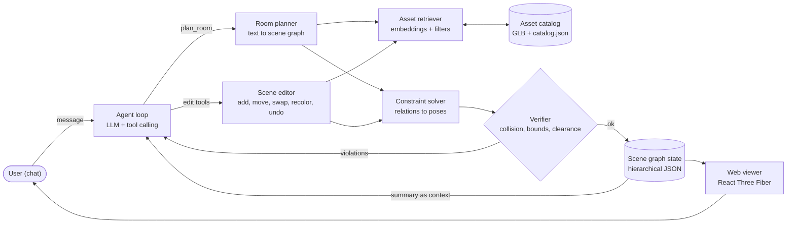

# StageChat — Project Materials, Resources & Plan

> **StageChat: A Tool-Using LLM Agent for Conversational 3D Room Staging**
> INFO 7375 · Semantic Intelligence in LLM · Northeastern University (Seattle) · Fall 2026 · Final Project (Assignment 5)
>
> Last verified: **2026-11-02** (decisions recorded in §3.4). Licenses and access rules change — re-check anything tagged 🔴 before you rely on it.

**How to use this document.** Section 1 describes the project: 1.1 can be pasted into `README.md`, and 1.2 feeds the Phase 1 introduction, technical contribution, and system design. Section 2 lists every external resource with an access tag, plus the materials you must build yourself. Section 3 is the schedule, the backup plans, and the cut list.

## Contents

1. [Introduction](#1-introduction)
   - 1.1 [Brief introduction (README-ready)](#11-brief-introduction-readme-ready)
   - 1.2 [Detailed introduction (with function scope)](#12-detailed-introduction)
2. [Resources & materials](#2-resources--materials)
   - 2.1 [Reading list — to understand the project](#21-reading-list--to-understand-the-project)
   - 2.2 [Repositories, datasets & services — with access tags](#22-repositories-datasets--services--with-access-tags)
   - 2.3 [Materials you must build yourself](#23-materials-you-must-build-yourself)
   - 2.4 [Pre-flight checklist](#24-pre-flight-checklist-this-week)
3. [Plan](#3-plan)
   - 3.1 [Timeline & milestones](#31-timeline--milestones)
   - 3.2 [Risks & backup plans](#32-risks--backup-plans)
   - 3.3 [Cut list](#33-cut-list)
   - 3.4 [Decisions](#34-decisions)
- [Appendix A. Suggested repository layout](#appendix-a-suggested-repository-layout)
- [Appendix B. Conventions & data formats](#appendix-b-conventions--data-formats)

---

## 1. Introduction

### 1.1 Brief introduction (README-ready)

**StageChat** is a domain-specific chatbot for conversational 3D room staging. Describe a room in plain language — *"a 4 × 5 m Scandinavian living room for a family with a cat, window on the north wall"* — and StageChat plans a furniture layout, retrieves matching 3D models from a curated asset catalog, places them with a constraint solver, and renders the room in your browser. Then keep talking: *"move the sofa under the window"*, *"swap the coffee table for a round one"*, *"make the armchair dark green"*. Under the hood, a tool-using LLM agent edits a hierarchical scene graph, and a verifier checks every edit for collisions, out-of-bounds objects, and blocked paths before it reaches the screen.

*Built as the final project for INFO 7375 (Semantic Intelligence in LLM) at Northeastern University, Fall 2026.*

### 1.2 Detailed introduction

#### 1.2.1 Motivation

Virtual staging — furnishing an empty or outdated room digitally — has become a mainstream real-estate tool, and listing platforms already offer AI restyling of room photos. Language is the most natural way for non-experts to express design intent ("cozier", "more open", "room for a reading corner"), and LLMs carry a lot of interior-design commonsense. However, research on LLM-based layout (Holodeck, LayoutVLM, FlairGPT) repeatedly finds that LLMs are weak at producing *numerically* precise, physically plausible layouts on their own. They work best when their output is structured — relations, constraints, scene graphs — and a solver or optimizer turns that structure into geometry.

Many LLM-driven scene systems focus on generating a scene from a single prompt. StageChat puts the emphasis on the **multi-turn editing loop**: the user and the agent refine one room together over many turns, and every edit must stay physically valid.

#### 1.2.2 Key idea

1. **Structure over coordinates.** The LLM never emits raw coordinates. It produces objects, attributes, and spatial relations; a deterministic solver turns them into poses (following Holodeck, I-Design, and LayoutVLM).
2. **Tools over free text.** Every change is a typed tool call (`add_object`, `move_object`, `swap_asset`, `set_color`, …) validated against a JSON Schema.
3. **Hierarchical scene memory.** The agent reads a compact room → zones → objects summary instead of a flat dump (inspired by ScanEdit's hierarchical scene graph).
4. **Verify, then commit.** After each tool call, a verifier checks collisions, room bounds, and door/walkway clearance. Violations go back to the agent to repair — a lightweight version of SceneWeaver's reason–act–reflect loop.

#### 1.2.3 System overview



#### 1.2.4 Function scope

Priority: **P0** = MVP (must ship) · **P1** = should have · **P2** = stretch · **Out** = explicitly out of scope.

| ID | Function | What it does | Priority |
|---|---|---|---|
| F1 | Room setup from text | Extracts room type, size (sensible defaults when missing), doors, and windows | P0 |
| F2 | Furniture planning | LLM proposes objects, attributes (style, color, material), and spatial relations as a scene graph | P0 |
| F3 | Asset retrieval | Dense retrieval over the asset catalog with hard filters (category, size limits) | P0 |
| F4 | Constraint-based placement | Solver converts relations into collision-free poses inside the room | P0 |
| F5 | 3D web viewer | React Three Fiber scene: orbit camera, click-to-select, object labels | P0 |
| F6 | Conversational editing | Add, remove, move, rotate, swap, recolor, change material, undo/redo — all via tool calls | P0 |
| F7 | Scene memory & references | Hierarchical scene graph with stable IDs; resolves phrases like "the chair by the window" | P0 |
| F8 | Verifier + repair loop | Checks every edit, sends violations back to the agent, rolls back failed edits | P0 |
| F9 | Evaluation harness | Benchmark runner, metrics, logging | P0 |
| F10 | Clarifying questions | Asks when a request is ambiguous (e.g., two matching chairs) | P1 |
| F11 | Explanations | Explains what changed and why | P1 |
| F12 | Lighting tool | "Cozier / brighter": color temperature, intensity, add a lamp | P1 |
| F13 | Accessibility check (RAG) | Retrieves clearance rules (e.g., ADA) and checks/explains them | P1 |
| F14 | Export | Save/load scene JSON; screenshot | P1 |
| F15 | Small fine-tuned model | LoRA-tuned open model as planner/tool-caller, compared with the API model | P2 |
| F16 | Visual self-critique | Render → VLM judge → agent revises | P2 |
| F17 | Photo → room | Seeds a scene from a room photo (Mira-Scene offline import, or a VLM-only fallback) | P2 |
| — | Generating new 3D meshes; part-level retexturing with generative models; multi-room floor plans; physics simulation; AR/VR; shopping/pricing | — | Out |

#### 1.2.5 Agent tool set (draft v1)

| Tool | Purpose | Main arguments |
|---|---|---|
| `plan_room` | Create a new scene from a description | `description`, `room_type?`, `size_m?` |
| `describe_scene` | Return the hierarchical summary (room → zones → objects) | `detail` |
| `find_assets` | Retrieve candidate models | `query`, `category?`, `max_dims_m?`, `k` |
| `add_object` | Add an object and its relations | `category` or `asset_id`, `relations[]`, `zone?` |
| `remove_object` | Delete an object | `object_id` |
| `move_object` | Move by relation ("next to the window") or by offset | `object_id`, `relation?`, `offset_m?` |
| `rotate_object` | Rotate around the vertical axis, or face a target | `object_id`, `angle_deg?`, `face?` |
| `swap_asset` | Replace the model, keep pose and relations | `object_id`, `query` |
| `set_color` | Recolor an object or one material slot | `object_id`, `slot?`, `color` |
| `set_material` | Apply a material preset (oak, leather, linen, …) | `object_id`, `slot?`, `preset` |
| `set_lighting` (P1) | Adjust warmth/intensity; add a lamp | `warmth?`, `intensity?` |
| `check_scene` | Run the verifier on demand | `rules?` |
| `undo` / `redo` | Edit history | `steps` |
| `ask_user` (P1) | Ask a clarifying question | `question`, `options?` |

#### 1.2.6 Course techniques covered

| Assignment 5 technique | How StageChat uses it | Related course material |
|---|---|---|
| Agentic Workflows & Tool Use (**core**) | Multi-turn agent loop with typed tools, verifier feedback, and repair | Week 6b Tool Use; Week 5a Human–Agent Interaction |
| Knowledge Augmentation & Retrieval (**core**) | Dense retrieval over the asset catalog; retrieved exemplars for in-context learning; optional design-rule RAG | Week 6a In-context Learning; Assignment 3 |
| Model Adaptation & Fine-Tuning (optional) | LoRA on synthetic instruction → tool-call data, compared with the API model | Week 4b Fine-tuning |

Evaluation draws on Week 4a (automatic evaluation of LLMs) and the four tool-use stages from Week 6b (task planning, tool selection, tool calling, response generation). Comparing Claude, OpenAI, and DeepSeek models on the same benchmark also serves the course's first learning outcome: comparing models in the LLM ecosystem to choose the best one for a task. Choosing the main model on a dev split and reporting results on a held-out test split avoids benchmark leakage (a Week 9 topic).

#### 1.2.7 Technical contributions (draft for Phase 1)

1. A tool-using chat agent for 3D room staging that keeps a hierarchical scene graph as working memory across turns.
2. A relation-based placement layer with a verifier/repair loop that keeps every LLM edit physically valid (no collisions, inside the room, clear door path).
3. A benchmark of room-generation prompts and multi-turn edit dialogues with programmatic checkers, plus an ablation study of the main design choices.
4. An open, browser-based implementation with a curated, license-clean asset catalog.

#### 1.2.8 Evaluation plan (summary)

- **Generation:** relation satisfaction rate, collision rate, out-of-bounds (OOB) rate, door/walkway clearance pass rate.
- **Editing:** instruction success rate (one programmatic checker per edit), tool-selection accuracy, argument validity, repair iterations, turns to success.
- **Efficiency:** latency and tokens (cost) per turn.
- **Ablations:**
  - A1 — LLM emits coordinates directly (LayoutGPT-style) vs. relations + solver
  - A2 — flat object list vs. hierarchical scene graph as context
  - A3 — verifier/repair loop on vs. off
  - A4 — retrieved exemplars (k-similar in-context learning) vs. zero-shot
  - A5 — large API model vs. small open model (± LoRA)
  - A6 — provider comparison: Claude vs. OpenAI vs. DeepSeek, same prompts and tools, full system only
- **Protocol:** split the benchmark into a **dev** set (prompt tuning and choosing the main model) and a held-out **test** set (all reported numbers). Run ablations A1–A5 with the main model only, to control cost. Repeat each run 3× and report the mean and spread.
- **Optional:** VLM-as-judge for style/prompt alignment; a small user study (ask the instructor first).

#### 1.2.9 Tech stack

| Layer | Choice | Notes |
|---|---|---|
| Frontend | React + Vite + TypeScript, `@react-three/fiber`, `@react-three/drei` | Viewer + chat UI |
| Backend | Python 3.11 + FastAPI + Pydantic (**decided**) | One language for the agent, retrieval, evaluation, and fine-tuning |
| Geometry | Oriented 2D footprints on the floor plane (e.g., Shapely) + height intervals | Fast collision and clearance checks |
| Retrieval | sentence-transformers text embeddings (+ OpenCLIP image embeddings) + FAISS | Reuse your Assignment 3 retriever code |
| LLM | Provider-agnostic adapter over Claude, OpenAI, and DeepSeek (main model chosen on the dev split); Qwen3-8B on Explorer for the small-model ablation | See §2.2 and M20 |
| Experiment tracking | Weights & Biases | Listed as a required tool in the syllabus |

---

## 2. Resources & materials

**Access tags used below**

| Tag | Meaning |
|---|---|
| 🟢 OPEN | Download or use directly. No request needed. |
| 🟡 ACCOUNT | Free sign-up or click-through; usually instant. |
| 🔴 REQUEST | Someone else must approve. Can take days or be rejected. **Request early.** |
| 💳 PAID | Needs billing or credits. |
| ✅ DONE | You already have it. |

> **Bottom line from the access check:** the MVP (P0) has exactly **one** external dependency that can block you: **LLM API access** 💳 — and any one of your three providers is enough to start. Everything else needed for P0 is 🟢. All 🔴 items are optional (P2), and each has a fallback in §3.2.

### 2.1 Reading list — to understand the project

⭐ = must read. Suggested order: Holodeck → ScanEdit → SceneWeaver → LayoutVLM → I-Design → LayoutGPT → FlairGPT.

**A. Core method papers**

| | Paper | Links | Read it for |
|---|---|---|---|
| ⭐ | Holodeck: Language Guided Generation of 3D Embodied AI Environments (CVPR 2024) | [arXiv](https://arxiv.org/abs/2312.09067) · [code](https://github.com/allenai/Holodeck) | LLM → spatial relational constraints → solver (DFS solver recommended); object selection; prompt formats |
| ⭐ | ScanEdit: Hierarchically-Guided Functional 3D Scan Editing (ICCV 2025) | [arXiv](https://arxiv.org/abs/2504.15049) · [project](https://aminebdj.github.io/scanedit/) | Hierarchical scene graph; turning vague instructions into object-level constraints; physical plausibility losses |
| ⭐ | SceneWeaver: All-in-One 3D Scene Synthesis with an Extensible and Self-Reflective Agent (NeurIPS 2025) | [arXiv](https://arxiv.org/abs/2509.20414) · [project](https://scene-weaver.github.io/) | Standardized tool interface; reason–act–reflect loop; self-evaluation criteria |
| ⭐ | LayoutVLM: Differentiable Optimization of 3D Layout via Vision-Language Models (CVPR 2025) | [arXiv](https://arxiv.org/abs/2412.02193) · [project](https://ai.stanford.edu/~sunfanyun/layoutvlm/) | Five spatial relations with differentiable costs; numeric initialization + relations; fine-tuning open models on synthetic data |
| ⭐ | I-Design: Personalized LLM Interior Designer (ECCV Workshops 2024) | [arXiv](https://arxiv.org/abs/2404.02838) | Multi-agent roles; JSON scene-graph schema; backtracking placement; LLM-based grading |
| | LayoutGPT: Compositional Visual Planning and Generation with Large Language Models (NeurIPS 2023) | [arXiv](https://arxiv.org/abs/2305.15393) · [code](https://github.com/weixi-feng/LayoutGPT) | CSS-style layout format; k-similar exemplar retrieval for in-context learning; OOB metric (your A1/A4 baseline) |
| | FlairGPT: Repurposing LLMs for Interior Designs (2025) | [arXiv](https://arxiv.org/abs/2501.04648) · [project](https://flairgpt.github.io) | Designer-workflow stages; a library of objective functions with language docstrings |

**B. Agent & tool-use foundations**

| | Resource | Link | Read it for |
|---|---|---|---|
| ⭐ | Tool Learning with Large Language Models: A Survey (Qu et al., 2024) — cited in Week 6b | [arXiv](https://arxiv.org/abs/2405.17935) | Four-stage workflow and per-stage metrics → your evaluation design |
| | ReAct: Synergizing Reasoning and Acting in Language Models (Yao et al., 2022) | [arXiv](https://arxiv.org/abs/2210.03629) | The reason–act loop |
| | Toolformer (Schick et al., 2023) — cited in Week 6b | [arXiv](https://arxiv.org/abs/2302.04761) | Tool-call formats; useful for the LoRA data idea |
| ⭐ | Claude tool use docs | [docs](https://platform.claude.com/docs/en/agents-and-tools/tool-use/overview) | Tool definitions, the `tool_use` / `tool_result` round trip, and **strict tool use** (schema-conformant calls) |
| ⭐ | OpenAI function calling guide | [docs](https://developers.openai.com/api/docs/guides/function-calling) | Responses API vs. Chat Completions; `strict: true` requires every property in `required` plus `additionalProperties: false`, and should be used with `parallel_tool_calls: false` |
| ⭐ | DeepSeek tool calls guide | [docs](https://api-docs.deepseek.com/guides/tool_calls/) · [thinking mode](https://api-docs.deepseek.com/guides/thinking_mode/) · [changelog](https://api-docs.deepseek.com/updates/) | OpenAI-compatible format at `https://api.deepseek.com`; strict mode is Beta; in thinking mode, tool-call loops must pass `reasoning_content` back in later requests |

**C. Background & context (where the idea came from)**

| Resource | Links | Why |
|---|---|---|
| Mira-Scene: Pixel-Aligned Layouts for Generative 3D Scene Reconstruction (HKU + VAST, 2026) | [arXiv](https://arxiv.org/abs/2609.23796) · [project](https://sunyangtian.github.io/Mira-Scene-web/) · [code](https://github.com/VAST-AI-Research/Mira-Scene) · [HF](https://huggingface.co/Yang-Tian/Mira-Scene) | Photo → compositional, editable scene; basis of stretch goal F17 |
| 机器之心 article on Mira-Scene (Chinese) | [WeChat](https://mp.weixin.qq.com/s/lkKNXcznAAEZT_T5ZGitmw) · [NetEase mirror](https://www.163.com/dy/article/L82NDC7T0511AQHO.html) | Original inspiration |
| 3D AI Lab (TUM, Angela Dai) — publications | [list](https://www.3dunderstanding.org/publications.html) | ScanEdit, DiffuScene ([arXiv](https://arxiv.org/abs/2303.14207)), SceneFactor ([arXiv](https://arxiv.org/abs/2412.01801)), WorldAgents |
| Virtual Home Staging: Inverse Rendering and Editing an Indoor Panorama under Natural Illumination (Ji et al., ISVC 2023) — the instructor's work | [arXiv](https://arxiv.org/abs/2311.12265) | Domain framing ("virtual staging"); lighting and rendering angle |
| Objaverse: A Universe of Annotated 3D Objects (2022) | [arXiv](https://arxiv.org/abs/2212.08051) | Background on the asset source |
| Industry context: Zillow's AI virtual staging | [article](https://seattleagentmagazine.com/?p=8646) | Motivation paragraph |

**D. Docs for the 3D web stack**

| Resource | Link | Use |
|---|---|---|
| three.js docs | https://threejs.org/docs/ | Materials, lights, loaders |
| React Three Fiber | https://r3f.docs.pmnd.rs/ | Declarative three.js in React (`@react-three/fiber@9` pairs with React 19; `@8` with React 18) |
| drei | https://drei.docs.pmnd.rs/ | `useGLTF`, `Environment`, `TransformControls`, `Html` labels |
| gltfjsx | https://github.com/pmndrs/gltfjsx | `--transform` compresses and optimizes GLBs |
| glTF-Transform | https://gltf-transform.dev | Scripted normalization/optimization pipeline |
| glTF 2.0 specification | https://registry.khronos.org/glTF/specs/2.0/glTF-2.0.html | Coordinate system and units (meters, +Y up, asset front faces +Z) |
| pmndrs docs MCP server (optional, for Claude Code) | `https://docs.pmnd.rs/api/sse` | Lets Claude Code query the R3F/drei docs |

**E. Retrieval, fine-tuning, tracking & domain rules**

| Resource | Link |
|---|---|
| sentence-transformers | https://www.sbert.net |
| OpenCLIP | https://github.com/mlfoundations/open_clip |
| FAISS | https://github.com/facebookresearch/faiss |
| Hugging Face PEFT (LoRA) | https://huggingface.co/docs/peft |
| Hugging Face TRL (SFT) | https://huggingface.co/docs/trl |
| Weights & Biases | https://docs.wandb.ai |
| U.S. Access Board — ADA guide to clear floor space & turning space (for F13) | https://www.access-board.gov/ada/guides/chapter-3-clear-floor-or-ground-space-and-turning-space |

**F. Course files (already in the course project)**

`Assignment_5__Domain_Specific_Chatbot.pdf` (requirements) · `week6b_tool-use.pdf` · `week6a_in-context_learning.pdf` · `week4a_auto-eval-llm.pdf` · `week4b_finetuning.pdf` · `week5a_human_agent_interaction.pdf` · your Assignment 3 code (retriever + RAG) · the course LaTeX template.

### 2.2 Repositories, datasets & services — with access tags

**A. Needed for the MVP (P0/P1)**

| Resource | Used for | Link | Access | License / notes | Priority |
|---|---|---|---|---|---|
| Claude API (Console) | Planner + editing agent — candidate 1 | https://platform.claude.com | 💳 (🔴 if using Team credits) | API usage is [billed separately](https://support.claude.com/en/articles/9876003) from claude.ai plans. Team plans include monthly API credits, but only the Team's **Primary Owner / Owner** can claim them by linking a Console organization ([help article](https://support.claude.com/en/articles/17154008-monthly-api-credits-for-max-and-team-plans)). Otherwise, buy prepaid credits. | P0 |
| OpenAI API | Candidate 2 | https://platform.openai.com | 💳 | Separate account, API key, and billing; set a monthly spend limit | P0 |
| DeepSeek API | Candidate 3 | [api-docs.deepseek.com](https://api-docs.deepseek.com/) | 💳 | Prepaid top-up. Model IDs changed with the V4 release — check the [changelog](https://api-docs.deepseek.com/updates/) before hard-coding them. No Northeastern-specific restriction found, but some universities restrict DeepSeek, so send it only synthetic project data | P0 |
| Kenney Furniture Kit | First asset catalog | https://kenney.nl/assets/furniture-kit | 🟢 | CC0 (no attribution required); 100+ low-poly furniture models; GLB/glTF | P0 |
| Poly Haven (models, textures, HDRIs) | Realistic assets, PBR materials, image-based lighting | https://polyhaven.com | 🟢 | CC0; has a public API | P0 (textures/HDRIs), P1 (models) |
| ambientCG | Extra PBR material presets | https://ambientcg.com | 🟢 | CC0 | P1 |
| Objaverse 1.0 (GLBs via the `objaverse` Python package) | Expanding the catalog for style variety | [docs](https://objaverse.allenai.org/docs/objaverse-1.0) · [HF](https://huggingface.co/datasets/allenai/objaverse) | 🟢 | Dataset under ODC-By, but **each object has its own CC license** (mostly CC-BY; some BY-SA / BY-NC / BY-NC-SA; a few CC0). Filter by the `license` field and keep attribution in `CREDITS.md`. LVIS category annotations help find furniture. Expect messy scale/orientation → normalize. | P1 |
| npm / pip libraries (R3F, drei, FastAPI, sentence-transformers, FAISS, Shapely, …) | Implementation | npm / PyPI | 🟢 | Permissive licenses | P0 |
| GitHub repository | Code submission | — | 🟡 | Private repo → invite the instructor and TA as collaborators (**get their GitHub usernames**), or submit an exported archive | P0 |
| Weights & Biases | Experiment tracking | https://wandb.ai | 🟡 | Free account | P1 |
| Course LaTeX template | Phase 1 and Phase 2 documents | Canvas / instructor | 🟡 | Required by Assignment 5 | P0 |

**B. Reference code (read and learn — check each LICENSE before copying any code, and cite what you reuse)**

| Repo | What to look at | Access | Notes |
|---|---|---|---|
| [allenai/Holodeck](https://github.com/allenai/Holodeck) | Constraint formats, DFS solver, prompts | 🟢 | Runs only on macOS/Ubuntu (AI2-THOR + Unity) and calls OpenAI GPT-4o — **read it, don't run it**. Its downloaded assets are converted for AI2-THOR, not web-ready GLBs. The README doesn't state a code license. |
| [allenai/objathor](https://github.com/allenai/objathor) | How Objaverse assets were annotated | 🟢 | Optional; AI2-THOR-specific |
| [weixi-feng/LayoutGPT](https://github.com/weixi-feng/LayoutGPT) | In-context-learning prompt format; `eval_scene_layout.py` (OOB, KL divergence) | 🟢 code / 🔴 data | Its 3D data depends on 3D-FUTURE (see C). The README doesn't state a code license. |
| [LayoutVLM project page](https://ai.stanford.edu/~sunfanyun/layoutvlm/) | Relation definitions and cost functions | 🟢 | Code is linked from the project page |
| [SceneWeaver project page](https://scene-weaver.github.io/) | Tool-interface design | 🟢 | Blender/IsaacSim-based |
| [ScanEdit project page](https://aminebdj.github.io/scanedit/) | Hierarchical-graph prompts | 🟢 | Code is linked from the project page |

**C. Optional / stretch (P2) — most of these are 🔴**

| Resource | Used for | Link | Access | Notes |
|---|---|---|---|---|
| 3D-FRONT / 3D-FUTURE | Layout exemplars; LayoutGPT data | [3D-FRONT](https://tianchi.aliyun.com/specials/promotion/alibaba-3d-scene-dataset) · [3D-FUTURE](https://tianchi.aliyun.com/specials/promotion/alibaba-3d-future) | 🔴 | Research use only; no sublicensing. A 2026 Hugging Face dataset card reports that the official download pages now return 404, and mirrors are gated behind the original terms of use. **Not needed** — write your own exemplars (M12). Never commit these files to your repo. |
| Qwen3-8B | LoRA small-model ablation (F15); local development model | https://huggingface.co/Qwen/Qwen3-8B | 🟢 | Apache-2.0, not gated; chat template supports tool calling; about 8 GB VRAM for 4-bit inference; Ollama: `ollama run qwen3:8b`. With your Explorer account, run LoRA training and batch evaluation there (e.g., serve the model with vLLM inside the job). |
| Northeastern Explorer HPC | GPU for LoRA, the small-model ablation, and Mira-Scene | [docs](https://rc-docs.northeastern.edu) · [partitions](https://rc.northeastern.edu/partitions) | ✅ active account | The `gpu` partition gives one GPU per job, with time limits; H200 GPUs (~140 GB) are available, and `gpu-short` usually starts sooner for quick tests. Use batch jobs for evaluation runs (don't plan on a long-running server); keep model weights out of your home directory; build CUDA-heavy environments on a GPU compute node. |
| Mira-Scene code + CCM checkpoint | Photo → room (F17) | [code](https://github.com/VAST-AI-Research/Mira-Scene) · [HF](https://huggingface.co/Yang-Tian/Mira-Scene) | 🟢 / 🟡 (HF login) | MIT license. The HF model card also links `github.com/vast-enterprise/Mira-Scene` — try that if one link breaks. Third-party checkpoints keep their own licenses. |
| SAM 3 | Segmentation stage of Mira-Scene | https://huggingface.co/facebook/sam3 | 🔴 | Gated; access approval required |
| SAM 3D Objects | Mesh stage of Mira-Scene | [code](https://github.com/facebookresearch/sam-3d-objects) · [HF](https://huggingface.co/facebook/sam-3d-objects) | 🔴 | Gated. Several requests have been reported as rejected; complete your HF profile with your full legal name and full organization name before applying. **Needs Linux and an NVIDIA GPU with ≥ 32 GB VRAM** — Explorer's H200s meet this, so access approval is now the main blocker. |
| Pixel-Perfect Depth | Depth stage of Mira-Scene | https://github.com/gangweix/pixel-perfect-depth | 🟢 | Needs extra checkpoints (Depth Anything V2-L or MoGe-2) |
| VLM API | Mira-Scene auto-segmentation (the paper used GPT-5.6; you can also draw masks by hand); F16 critique | Your provider | 💳 | Can be the same provider as your agent |

### 2.3 Materials you must build yourself

| ID | Artifact | Purpose | Target | Needed by | Notes |
|---|---|---|---|---|---|
| M1 | Asset catalog (`assets/catalog.json` + normalized GLBs) | Retrieval and rendering | 100 (MVP) → ~250 | Nov 10 / Dec 1 | Fields in Appendix B. Start with Kenney + Poly Haven. |
| M2 | Normalization script | Consistent assets | — | Nov 10 | Meters, +Y up, front faces +Z, pivot at bottom center, compressed; per-asset overrides; validation report |
| M3 | Thumbnails (1–4 views per asset) | Image embeddings, VLM annotation, UI | All assets | Nov 14 | Headless three.js or Blender |
| M4 | Retrieval index | `find_assets`, `swap_asset` | — | Nov 14 | Text (+ image) embeddings in FAISS, plus hard filters |
| M5 | Scene-graph JSON Schema (versioned) | Single source of truth for scene state | v0 → v1 | Nov 6 | Room, openings, zones, objects, relations, materials, lights |
| M6 | Tool specs (one JSON Schema per tool) | Tool calling | ~12 tools | Nov 18 | Mirrors §1.2.5 |
| M7 | Relation vocabulary + solver rules | Placement and checking | 8–10 relations | Nov 12 | Each relation = a placement rule + a checker predicate (see Appendix B) |
| M8 | Material & lighting presets | `set_material`, `set_lighting`, better screenshots | 8–12 materials, 2–3 HDRIs | Nov 20 | CC0 textures/HDRIs from Poly Haven / ambientCG |
| M9 | Room-generation prompt set | Generation benchmark | ~50 prompts | Nov 27 | 3 room types × simple / functional / constrained; split ~⅓ dev / ⅔ test |
| M10 | Edit benchmark (dialogues + checkers) | Editing benchmark | ~30 dialogues, ~150 edits | Nov 30 | Categories: add, remove, move, relational, recolor, material, swap, undo, ambiguous, multi-step; same dev/test split |
| M11 | Metric scripts | Results section | — | Nov 30 | Collision, OOB, clearance, relation satisfaction, success rate, tool accuracy, latency, tokens |
| M12 | Prompt library + exemplar layouts | Planner/agent prompts; k-similar in-context learning | 10–20 exemplars | Nov 16 | Self-authored; replaces 3D-FRONT exemplars |
| M13 | (opt) Synthetic SFT data | LoRA (F15) | 2–5 K pairs | Dec 3 | Templates + LLM paraphrases, each validated by executing the call |
| M14 | (opt) Design-rule corpus | F13 RAG | 30–60 short rules | Dec 1 | ADA clearance rules (U.S. government source) + your own documented rules |
| M15 | (opt) Demo room photos | F17 | 3–5 photos | Dec 3 | Your own photos (no people) or CC0 images |
| M16 | (opt) User-study kit | Human evaluation | 5–8 participants | Dec 5 | Tasks and a short questionnaire; **ask the instructor first** |
| M17 | `CREDITS.md` (auto-generated from M1) | License compliance | — | Dec 12 | Required for CC-BY assets |
| M18 | Report assets | Phase 2 document | — | Dec 12 | System diagram, screenshots, tables, an AI-use statement |
| M19 | `.env.example`, `.gitignore`, cost log | Safety and budget | — | Nov 4 | Never commit API keys, raw downloads, or restricted datasets |
| M20 | LLM provider adapter + response cache | Swap Claude / OpenAI / DeepSeek without touching agent code; reproducible runs | 3 providers | Nov 10 | One canonical tool format (JSON Schema) translated per provider; a tool-loop test per provider; log model ID, temperature, tokens, and latency; cache responses keyed by a request hash |

### 2.4 Pre-flight checklist (this week)

- [ ] Submit Phase 1 (**Nov 3, 11:59 PM**).
- [ ] Create API keys for Claude, OpenAI, and DeepSeek; set a spend limit on each; complete one tool-call round trip per provider from a script.
- [ ] If using Claude Team credits: ask the Team Owner to link a Console organization; otherwise, add prepaid credits.
- [ ] Download the Kenney Furniture Kit and render one GLB in React Three Fiber.
- [ ] Create the private GitHub repo with `.gitignore` (exclude `.env` and `assets/raw/`), a `LICENSE`, and a `CREDITS.md` stub.
- [ ] Ask the instructor: (1) the course policy on AI coding assistants and how to disclose their use (see also Northeastern's [Policy 125 on the Use of AI Systems](https://policies.northeastern.edu/policy125/)); (2) whether a small classmate user study is OK; (3) the instructor's and TA's GitHub usernames.
- [ ] Explorer (account active ✅): run one short test job on `gpu-short` and create a conda environment.
- [ ] Only if you plan F17: request Hugging Face access to SAM 3 and SAM 3D Objects now (complete your HF profile first).
- [ ] (Optional) Create a W&B project.

---

## 3. Plan

### 3.1 Timeline & milestones

Deadlines: Phase 1 **Nov 3**, Assignment 4 **Nov 24**, Phase 2 **Dec 15 (11:59 PM)**. U.S. Thanksgiving is Nov 26.

| Sprint | Dates | Goal | Deliverables | Exit criteria |
|---|---|---|---|---|
| S0 | Nov 2–3 | Phase 1 + unblock | Phase 1 PDF; working API key; access requests filed | Phase 1 submitted |
| S1 | Nov 4–10 | Thin end-to-end skeleton | Repo scaffold; scene schema v0 (M5); 60–100 normalized assets (M1–M2); viewer; LLM adapter for all 3 providers (M20) | A hand-written scene JSON renders; `add_object` works from chat with every provider |
| S2 | Nov 11–17 | Text → room | Planner prompt (M12); retrieval index (M3–M4); solver v1 (M7); 3 room types | 10 sample prompts → valid scenes (0 collisions, 0 OOB) |
| S3 | Nov 18–24 | Conversational editing | Tool set (M6); hierarchical context; verifier + repair; undo/redo; materials (M8) | 20 scripted edit dialogues pass (lighter week: A4 due 11/24) |
| S4 | Nov 25–Dec 1 | Benchmark + model selection | M9–M11 with the dev/test split; catalog → ~250 assets; all 3 providers on the dev split → choose the main model | Main model frozen; first complete results table on the test split |
| S5 | Dec 2–8 | Ablations + optional features | A1–A5 with the main model; A6 provider comparison on the test split; optional F12–F17; screenshots | **Feature freeze Dec 8** |
| S6 | Dec 9–15 | Write and ship | 8-page report; README; CREDITS; cleanup; optional demo video | Submitted — aim for Dec 14 to keep a buffer |

### 3.2 Risks & backup plans

| Stage | Risk | Early warning | Backup plan |
|---|---|---|---|
| S0–S1 | No API credits / billing issue | No credits visible in the Console by Nov 5 | (1) Team Owner links a Console org; (2) small prepaid top-up; (3) develop on local Qwen3-8B (Ollama) and run only the final evaluations on the API model |
| S1 | Provider differences break the agent loop (tool-call formats, parallel calls, schema strictness, DeepSeek `reasoning_content`) | A tool-loop test passes on one provider but fails on another | Canonical tool format + per-provider adapter tests (M20); disable parallel tool calls; validate every call against your own JSON Schema instead of relying only on provider strict modes; drop a provider from A6 if it can't pass the tests by Nov 24 |
| S1–S5 | A provider has outages, rate limits, or slow responses | Timeouts or HTTP 429 errors during evaluation | Retries with exponential backoff; response cache; run providers in separate batches; continue with the other two |
| S4 | Picking the "best" model on the data you report (selection bias) | Choosing a model by looking at test numbers | Select on the dev split only; freeze the choice; report everything on the test split |
| S4–S5 | API cost grows with 3 providers × ablations × repeats | Cost log above your budget | Run A1–A5 with the main model only; cache responses; use cheaper model tiers during development |
| S1 | Asset normalization eats the week | More than 2 days spent on assets | Freeze the MVP catalog at Kenney + Poly Haven; add Objaverse later, only for variety |
| S1 | Heavy models slow the browser | Load > 5 s or a choppy frame rate | `gltfjsx --transform` / glTF-Transform (compress, shrink textures, simplify); instancing |
| S1 | Windows tooling problems (Python geometry/ML packages) | Install errors | Run the backend in WSL2 (Ubuntu); keep the frontend on Windows |
| S2 | LLM returns invalid scene graphs | Schema validation failures | Strict tool use / JSON Schema + automatic retry with the validator's error message; simplify the schema |
| S2 | Solver can't fit crowded rooms | Unsatisfiable layouts | Drop the lowest-priority relations first; backtracking (I-Design style); scored grid search; cap the object count |
| S2 | Retrieval picks the wrong items | Low top-1 category accuracy | Hard category filter + embeddings + LLM re-ranking of the top 5; fix metadata |
| S3 | Wrong object edited ("the other chair") | Reference errors in test dialogues | Descriptive stable names (`armchair_left`); the `ask_user` tool; spatial descriptors in the context |
| S3 | Multi-step requests half-applied | Partial edits | Plan-then-execute; transactional edits (apply all or roll back) |
| S3 | Part-level recolor impossible (single-material asset) | User asks for "only the cushions" | Recolor the whole object and say so; list it as a limitation |
| S4 | Checkers too strict or brittle | Many false failures | Loosen thresholds; LLM-as-judge with a rubric for subjective edits + a 10% manual audit |
| S4 | Benchmark not ready | Fewer than 100 edits by Nov 28 | Generate candidates from templates with an LLM and verify them by hand; shrink to 100 edits |
| S5 | Explorer queue waits or job time limits | Jobs pending for hours; runs killed at the time limit | Use `gpu-short` for tests; checkpoint training; shrink the LoRA run (fewer steps, 4-bit QLoRA); last resort: skip LoRA and run the in-context-learning ablation (A4) instead |
| S5 | Mira-Scene blocked (HF rejection, environment errors, GPU queue) | Not running by Dec 4 | Drop it. Fallback "F17-lite": a VLM reads a room photo and seeds the scene graph (room type, rough size, style, furniture list) — API only, no GPU |
| Any | A sprint runs more than 3 days late | Missed exit criteria | Apply the cut list (§3.3) and report the cuts honestly under Limitations |

### 3.3 Cut list

If you fall behind, cut in this order:

1. F17 Photo → room (Mira-Scene)
2. F15 LoRA small model
3. F16 Visual self-critique
4. User study
5. F13 Accessibility RAG
6. F12 Lighting tool
7. Objaverse catalog expansion (keep Kenney + Poly Haven)

**Never cut:** F1–F9 and ablations A1–A3. They are the core contribution and the Results section.

### 3.4 Decisions

| Decision | Choice (Nov 2) | Consequence |
|---|---|---|
| LLM provider | Compare **Claude, OpenAI, and DeepSeek**; keep the best one on the dev split as the main model | Provider adapter (M20); ablation A6; dev/test protocol (§1.2.8) |
| Backend language | **Python 3.11 + FastAPI** | One language for the agent, retrieval, evaluation, and fine-tuning |
| GPU work (F15/F17) | **Explorer account active** | F15 (LoRA) is realistic; F17 now depends only on Hugging Face access approval |

---

## Appendix A. Suggested repository layout

```text
stagechat/
├── README.md
├── PROJECT_MATERIALS.md        # this file
├── CREDITS.md                  # auto-generated asset attributions
├── LICENSE
├── .env.example                # API keys go in .env (git-ignored)
├── apps/
│   └── web/                    # React + Vite + R3F viewer and chat UI
├── server/
│   ├── api.py                  # FastAPI endpoints
│   ├── agent/                  # agent loop, tool definitions, prompts
│   ├── llm/                    # provider adapters (Claude, OpenAI, DeepSeek) + response cache
│   ├── scene/                  # schema, solver, verifier
│   └── retrieval/              # embeddings, FAISS index
├── assets/
│   ├── raw/                    # downloads (git-ignored)
│   ├── processed/              # normalized GLBs (Git LFS or a download script)
│   ├── thumbs/
│   └── catalog.json
├── tools/
│   ├── normalize_assets.py
│   ├── render_thumbnails.*
│   └── build_index.py
├── eval/
│   ├── prompts/                # room-generation prompts (M9)
│   ├── edits/                  # dialogues + checkers (M10)
│   ├── splits/                 # dev / test ID lists
│   ├── metrics.py
│   └── run_eval.py
└── report/                     # LaTeX, figures, screenshots
```

## Appendix B. Conventions & data formats

**Units & axes.** Meters. +Y is up, and an object's front faces +Z (the glTF convention). The floor is at y = 0. Room coordinates: x ∈ [0, width] runs west → east, z ∈ [0, depth] runs south → north. `rot_y_deg = 0` means the object faces +Z (north). Each object's pivot is the bottom center of its bounding box. Collisions are checked on the floor plane as oriented rectangles plus height intervals.

**Catalog record (`assets/catalog.json`)**

```json
{
  "id": "kenney_sofa_01",
  "name": "three-seat lounge sofa",
  "category": "sofa",
  "tags": ["three-seat", "fabric"],
  "style": ["modern", "minimal"],
  "dims_m": { "w": 2.0, "d": 0.9, "h": 0.8 },
  "placement": "floor",
  "material_slots": ["fabric", "legs"],
  "default_colors": { "fabric": "#8A8F98", "legs": "#3B2F2F" },
  "front": "+Z",
  "license": "CC0-1.0",
  "author": "Kenney",
  "source_url": "https://kenney.nl/assets/furniture-kit",
  "file": "assets/processed/kenney_sofa_01.glb",
  "thumbnail": "assets/thumbs/kenney_sofa_01.png"
}
```

**Scene graph (excerpt)**

```json
{
  "schema_version": "0.1",
  "room": {
    "type": "living_room",
    "size_m": { "width": 4.0, "depth": 5.0, "height": 2.7 },
    "openings": [
      { "id": "door_1", "type": "door", "wall": "east", "offset_m": 0.5, "width_m": 0.9 },
      { "id": "window_1", "type": "window", "wall": "north", "offset_m": 1.2, "width_m": 1.6, "sill_m": 0.8 }
    ]
  },
  "zones": [
    { "id": "zone_seating", "label": "seating area", "objects": ["sofa_1", "coffee_table_1"] }
  ],
  "objects": [
    {
      "id": "sofa_1",
      "name": "grey three-seat sofa",
      "category": "sofa",
      "asset_id": "kenney_sofa_01",
      "pose": { "x": 2.0, "z": 0.5, "rot_y_deg": 0 },
      "materials": { "fabric": { "color": "#8A8F98" } }
    },
    {
      "id": "coffee_table_1",
      "name": "oak coffee table",
      "category": "coffee_table",
      "asset_id": "kenney_table_coffee_01",
      "pose": { "x": 2.0, "z": 1.6, "rot_y_deg": 0 },
      "materials": { "top": { "preset": "oak" } }
    }
  ],
  "relations": [
    { "type": "against_wall", "subject": "sofa_1", "target": "wall_south" },
    { "type": "in_front_of", "subject": "coffee_table_1", "target": "sofa_1" }
  ]
}
```

**Relation vocabulary (v1 — thresholds are starting values to tune)**

| Relation | Meaning | Checker predicate |
|---|---|---|
| `against_wall(a, wall)` | a's back touches the wall | back edge within 0.05 m of the wall; a faces away from it |
| `facing(a, b)` | a's front points at b | angle between a's front and the direction to b ≤ 30° |
| `next_to(a, b)` | side by side | edge gap ≤ 0.3 m; no overlap |
| `in_front_of(a, b)` | a sits in front of b | a inside b's front sector, 0.3–1.2 m away |
| `near_opening(a, o)` | close to a window or door | within 1.0 m of o, without blocking it |
| `centered_in(a, zone_or_room)` | centered | center offset ≤ 0.2 m |
| `on_top_of(a, b)` | a rests on b | a's bottom = b's top ± 0.02 m; footprint inside b |
| `aligned_with(a, b)` | parallel and edge-aligned | rotation difference ≤ 5°; edge offset ≤ 0.05 m |

**Global verifier rules.** No overlaps (except `on_top_of`); every object inside the room bounds; a free clearance zone in front of each door; optionally (strict/accessibility mode) a 0.91 m (36 in) walkway from the door to every zone, following the ADA accessible-route width.
